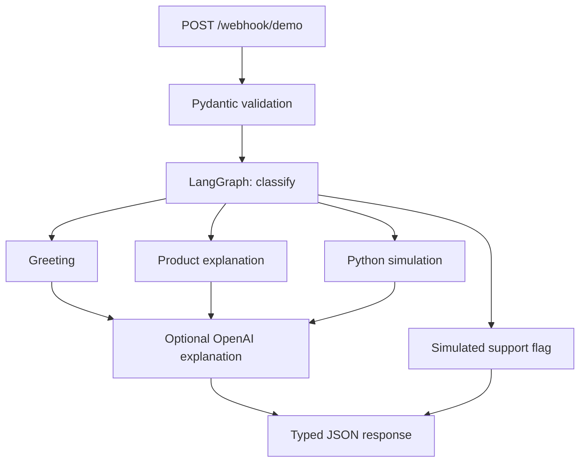

# Bank Customer Support Demo

**Kiarash Torabi** — a small educational portfolio project inspired by the structure
of [AI-Telecom-Customer-Support](https://github.com/Kialojer/AI-Telecom-Customer-Support).

A customer receives an investment offer and asks: **What does it mean? How much
might this scenario return? Can I withdraw the money earlier?**

This sample uses **LangGraph + FastAPI + Pydantic**, with optional OpenAI explanations.
It supports **Brazilian Portuguese and English**. Products and rates are fictional,
not live offers from any bank. No account access, trading or personal recommendation.

## Files

| File | Purpose |
| --- | --- |
| [graph.py](graph.py) | State, keyword router, four paths and visible LangGraph wiring |
| [products.py](products.py) | Three fictional products and Python calculations |
| [llm.py](llm.py) | Optional OpenAI explanation; deterministic fallback on failure |
| [main.py](main.py) | Small FastAPI ingress and typed response |
| [test_demo.py](test_demo.py) | Offline behavior tests with a real compiled graph |
| [HLD.md](HLD.md) | High-level design, data boundaries and scope |
| [architecture.drawio](architecture.drawio) | Editable diagrams.net architecture |
| [requirements.txt](requirements.txt) | Dependency ranges |
| [VERIFICATION.md](VERIFICATION.md) | What was actually checked |

There is no database, SQL adapter, vector store, UI framework or multi-agent system.
The router uses simple keyword matching, not an LLM classifier. OpenAI only explains
facts after routing; this is a bounded workflow, not an autonomous financial agent.

## Architecture



The calculator owns numbers. The model never selects a product, changes the numeric
scenario or executes a financial operation. Support requests bypass OpenAI entirely.

## Run the simplest example

Python 3.11+; from this folder in PowerShell:

```powershell
python -m venv .venv
.\.venv\Scripts\python.exe -m pip install -r requirements.txt
.\.venv\Scripts\python.exe graph.py
```

This uses the real graph with local templates. No key or paid call is needed.

## Try the API

```powershell
.\.venv\Scripts\python.exe -m uvicorn main:app --host 127.0.0.1 --port 8000
```

Open **http://127.0.0.1:8000/docs**. Try `GET /products`, then
`POST /webhook/demo`:

```json
{
  "message": "Quanto rende esta oferta?",
  "language": "pt-BR",
  "product_id": "demo-cdb",
  "scenario": {
    "amount": 5000,
    "days": 180,
    "assumed_tax_rate": 0,
    "needs_daily_liquidity": true
  },
  "history": []
}
```

Expected: `intent: simulate`, `mode: demo`, estimated total **R$ 5287.40**.
The zero tax is only a user assumption; it is not a statement that CDBs are tax-free.

Other examples:
- `"Hello"`, language `en`: greeting.
- `"Explain this offer"`, product `demo-lci`: product explanation.
- `"How much will it return?"`, product `demo-lca`, 180 days: locked, no withdrawal estimate.
- `"I need human support"`: simulated support flag. No real transfer occurs.

The **product_id and scenario fields are authoritative**. To switch products or
amounts, change these fields; text such as “use 10,000 instead” does not change the
calculator. Template mode only covers the demonstrated routes, not arbitrary Q&A.

## Optional OpenAI

Set these variables in the same terminal before starting the server:

```powershell
$env:USE_OPENAI = "true"
$env:OPENAI_API_KEY = "YOUR_KEY"
$env:OPENAI_MODEL = "gpt-4o-mini"
```

No call occurs unless `USE_OPENAI=true`. A missing key or provider failure returns
the template with `mode: fallback`; a successful call returns `mode: openai`.
The example env file is documentation only and is not loaded automatically.
OpenAI usage may incur charges.

## Conversation and privacy

Each request has fresh graph state, with **no checkpointer or server history store**.
For a contextual follow-up in OpenAI mode, the client explicitly sends up to six
previous user/assistant messages in `history`, using the same product and scenario.
That history is client-supplied and untrusted. Template mode does not interpret it.

No database or application-level message logging is implemented. Data exists in
RAM while processing. AI mode sends the question, recent messages, scenario and
fictional product facts to OpenAI with `store=False`; that is **not zero-retention
assurance**. Tracing services are not configured; do not enable external tracing
with private data. Use synthetic inputs only, and keep keys out of GitHub.

## Calculator assumptions

Three **fictional fixed-rate** CDB/LCI/LCA examples. Effective annual compounding,
calendar days/365. Tax on positive gain uses only the supplied assumption.
No Brazilian tax engine, fees, IOF, inflation, default model or reinvestment.
Rates are constants, not CDI forecasts. A result can be mathematically calculable
while failing the daily-liquidity filter. Beyond-maturity estimates are omitted.

## Scope

This localhost sample is **not a real Meta WhatsApp webhook**. It does not send
notifications, connect to a bank, authenticate customers, assess suitability,
recommend the “best investment”, cross-sell or create support tickets.
`handoff=true` is a demonstration flag only.

Before any public deployment, add authentication, quotas, request-size controls,
provider-cost limits, verified event handling and appropriate privacy/legal review.
No public service has been deployed by this repository update.

## Verify

```powershell
.\.venv\Scripts\python.exe -m unittest -v
```

Read [HLD.md](HLD.md) for the design. Open `architecture.drawio` in
https://app.diagrams.net/ using **File > Open From > Device**.

## Portfolio description (Portuguese)

Prototipo educacional de atendimento bancario com LangGraph, FastAPI e Pydantic:
roteamento por intencao, explicacao de produtos ficticios, simulacao deterministica,
respostas em portugues e ingles e integracao opcional com OpenAI. Sem acesso a
contas ou execucao de investimentos.

## References

- https://docs.langchain.com/oss/python/langgraph/graph-api
- https://fastapi.tiangolo.com/tutorial/body/
- https://developers.openai.com/api/docs/guides/text
