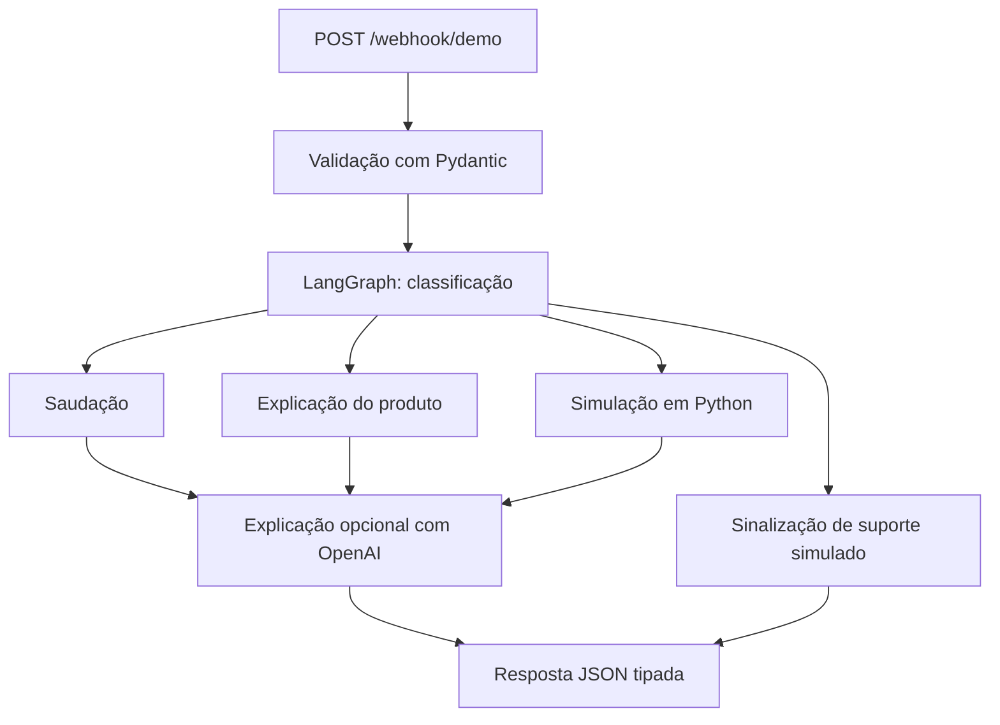

# Demonstração de Atendimento Bancário

**Kiarash Torabi** — um pequeno projeto educacional de portfólio inspirado na
estrutura de [AI-Telecom-Customer-Support](https://github.com/Kialojer/AI-Telecom-Customer-Support).

Um cliente recebe uma oferta de investimento e pergunta: **O que isso significa?
Quanto esse cenário pode render? Posso resgatar o dinheiro antes do prazo?**

O exemplo utiliza **LangGraph + FastAPI + Pydantic**, com explicações opcionais
da OpenAI. Oferece respostas em **português brasileiro e inglês**. Os produtos
e as taxas são fictícios, não ofertas atuais de bancos. Não há acesso a contas,
execução de operações ou recomendação personalizada.

## Arquivos

| Arquivo | Finalidade |
| --- | --- |
| [graph.py](graph.py) | Estado, classificação por palavras-chave, quatro caminhos e montagem explícita do LangGraph |
| [products.py](products.py) | Três produtos fictícios e cálculos em Python |
| [llm.py](llm.py) | Explicação opcional com OpenAI; resposta local em caso de falha |
| [main.py](main.py) | Entrada da API com FastAPI e resposta tipada |
| [test_demo.py](test_demo.py) | Testes de comportamento sem serviços externos, com o grafo compilado real |
| [HLD.md](HLD.md) | Arquitetura de alto nível, limites dos dados e escopo |
| [architecture.drawio](architecture.drawio) | Arquitetura editável no diagrams.net |
| [requirements.txt](requirements.txt) | Faixas de versões das dependências |
| [VERIFICATION.md](VERIFICATION.md) | Registro do que foi efetivamente verificado |

Não há banco de dados, adaptador SQL, armazenamento vetorial, framework de
interface ou sistema multiagente. A classificação usa palavras-chave simples,
não um LLM. A OpenAI apenas explica os dados após o roteamento: trata-se de um
fluxo com limites definidos, não de um agente financeiro autônomo.

## Arquitetura



A calculadora é responsável pelos números. O modelo não seleciona produtos,
não altera o cenário numérico e não executa operações financeiras. Solicitações
de suporte seguem um caminho que não chama a OpenAI.

## Executar o exemplo mais simples

Utilize Python 3.11 ou superior. Nesta pasta, execute no PowerShell:

```powershell
python -m venv .venv
.\.venv\Scripts\python.exe -m pip install -r requirements.txt
.\.venv\Scripts\python.exe graph.py
```

O exemplo executa o grafo real com respostas locais predefinidas. Não é necessário
ter uma chave de API, e nenhuma chamada paga é realizada.

## Experimentar a API

```powershell
.\.venv\Scripts\python.exe -m uvicorn main:app --host 127.0.0.1 --port 8000
```

Abra **http://127.0.0.1:8000/docs**. Experimente `GET /products` e, em seguida,
`POST /webhook/demo`:

```json
{
  "message": "Quanto rende esta oferta?",
  "language": "pt-BR",
  "product_id": "demo-cdb",
  "scenario": {
    "amount": 5000,
    "days": 180,
    "assumed_tax_rate": 0,
    "needs_daily_liquidity": true
  },
  "history": []
}
```

Resultado esperado: `intent: simulate`, `mode: demo` e total estimado de
**R$ 5.287,40**. O imposto zero é apenas uma premissa informada no cenário;
não significa que CDBs sejam isentos de imposto.

Outros exemplos:

- `"Olá"`, idioma `pt-BR`: saudação.
- `"Explique esta oferta"`, produto `demo-lci`: explicação do produto.
- `"Quanto rende?"`, produto `demo-lca`, prazo de 180 dias: produto bloqueado,
  sem estimativa de resgate.
- `"Preciso de um atendente humano"`: sinalização de suporte simulado.
  Nenhum encaminhamento real é realizado.
- `"Hello"`, idioma `en`: saudação em inglês.

Os campos **product_id e scenario determinam o produto e os parâmetros do cálculo**.
Para trocar o produto ou o valor, altere esses campos. Escrever algo como
“use 10.000 em vez disso” na mensagem não modifica a calculadora. O modo de
respostas predefinidas cobre apenas os caminhos demonstrados, não perguntas abertas.

## Integração opcional com OpenAI

Defina estas variáveis no mesmo terminal antes de iniciar o servidor:

```powershell
$env:USE_OPENAI = "true"
$env:OPENAI_API_KEY = "SUA_CHAVE"
$env:OPENAI_MODEL = "gpt-4o-mini"
```

Chamadas ao modelo só são habilitadas com `USE_OPENAI=true`. Se faltar a chave
ou ocorrer uma falha no provedor, a resposta local é retornada com
`mode: fallback`. Uma chamada bem-sucedida retorna `mode: openai`.
O arquivo de exemplo de variáveis de ambiente serve apenas como documentação
e não é carregado automaticamente. O uso da API OpenAI pode gerar cobranças.

## Conversa e privacidade

Cada requisição inicia um novo estado do grafo, **sem checkpointer ou armazenamento
de histórico no servidor**. Para uma pergunta de acompanhamento com contexto
no modo OpenAI, o cliente envia explicitamente até seis mensagens anteriores
de usuário e assistente em `history`, mantendo o mesmo produto e cenário.
Esse histórico é fornecido pelo cliente e tratado como conteúdo não confiável.
O modo de respostas predefinidas não o interpreta.

Não há banco de dados nem registro de mensagens implementado pela aplicação.
Os dados existem em memória RAM durante o processamento. No modo IA, a pergunta,
as mensagens recentes, o cenário e os dados fictícios do produto são enviados
à OpenAI com `store=False`; isso **não garante retenção zero pelo provedor**.
Serviços de rastreamento de execução não estão configurados. Não habilite
rastreamento externo com dados privados. Utilize apenas dados sintéticos
e mantenha as chaves fora do GitHub.

## Premissas da calculadora

São três exemplos de CDB, LCI e LCA com **taxas prefixadas fictícias**.
O cálculo usa capitalização a uma taxa anual efetiva e dias corridos/365.
O imposto sobre o ganho positivo considera somente a premissa informada.

Não há implementação das regras tributárias brasileiras, taxas, IOF, inflação,
modelo de inadimplência ou reinvestimento. As taxas são constantes, não projeções
do CDI. Um cenário pode permitir o cálculo e, ainda assim, não atender ao filtro
de liquidez diária. Não são produzidas estimativas para prazos além do vencimento.

## Escopo

Este exemplo local **não é um webhook real da API do WhatsApp da Meta**.
Não envia notificações, não se conecta a bancos, não autentica clientes,
não avalia a adequação ao perfil do investidor, não recomenda o “melhor investimento”,
não realiza venda cruzada e não cria chamados de atendimento.
`handoff=true` é apenas uma sinalização demonstrativa.

Antes de uma implantação pública, é necessário adicionar autenticação, cotas,
limites de tamanho das requisições, controle de custos do provedor, verificação
de eventos e a análise jurídica e de privacidade pertinente.
Esta atualização do repositório não implantou nenhum serviço público.

## Verificação

```powershell
.\.venv\Scripts\python.exe -m unittest -v
```

Consulte [HLD.md](HLD.md) para entender a arquitetura. Abra `architecture.drawio`
em https://app.diagrams.net/ pela opção **File > Open From > Device**.

## Descrição para o portfólio

Protótipo educacional de atendimento bancário com LangGraph, FastAPI e Pydantic:
roteamento por intenção, explicação de produtos fictícios, simulação determinística,
respostas em português e inglês e integração opcional com OpenAI.
Sem acesso a contas ou execução de investimentos.

## Referências

- https://docs.langchain.com/oss/python/langgraph/graph-api
- https://fastapi.tiangolo.com/tutorial/body/
- https://developers.openai.com/api/docs/guides/text
